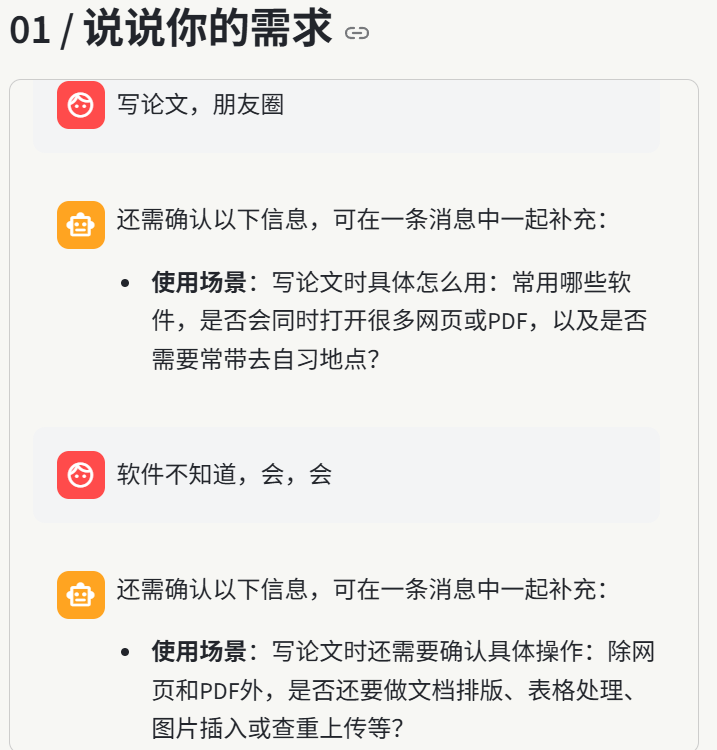
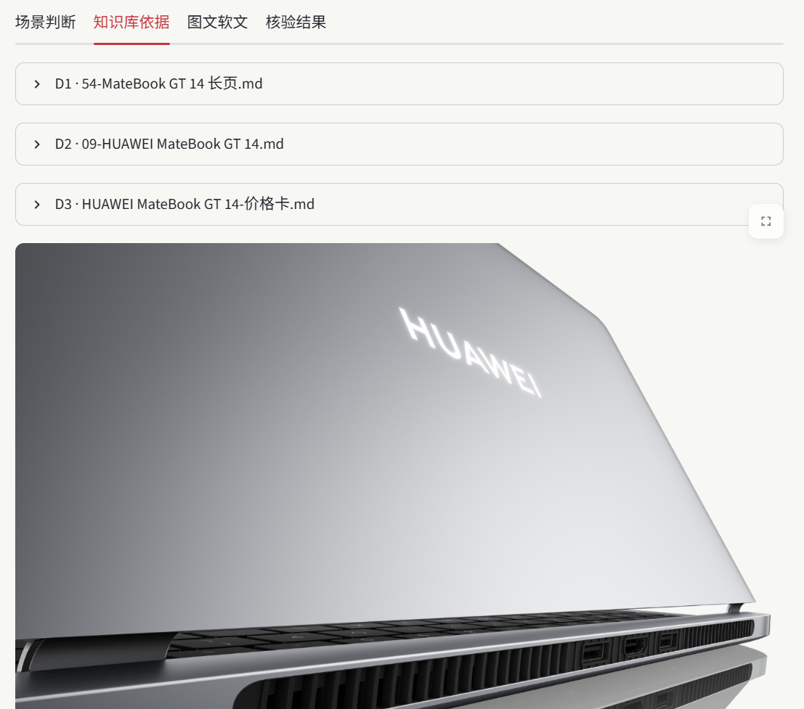
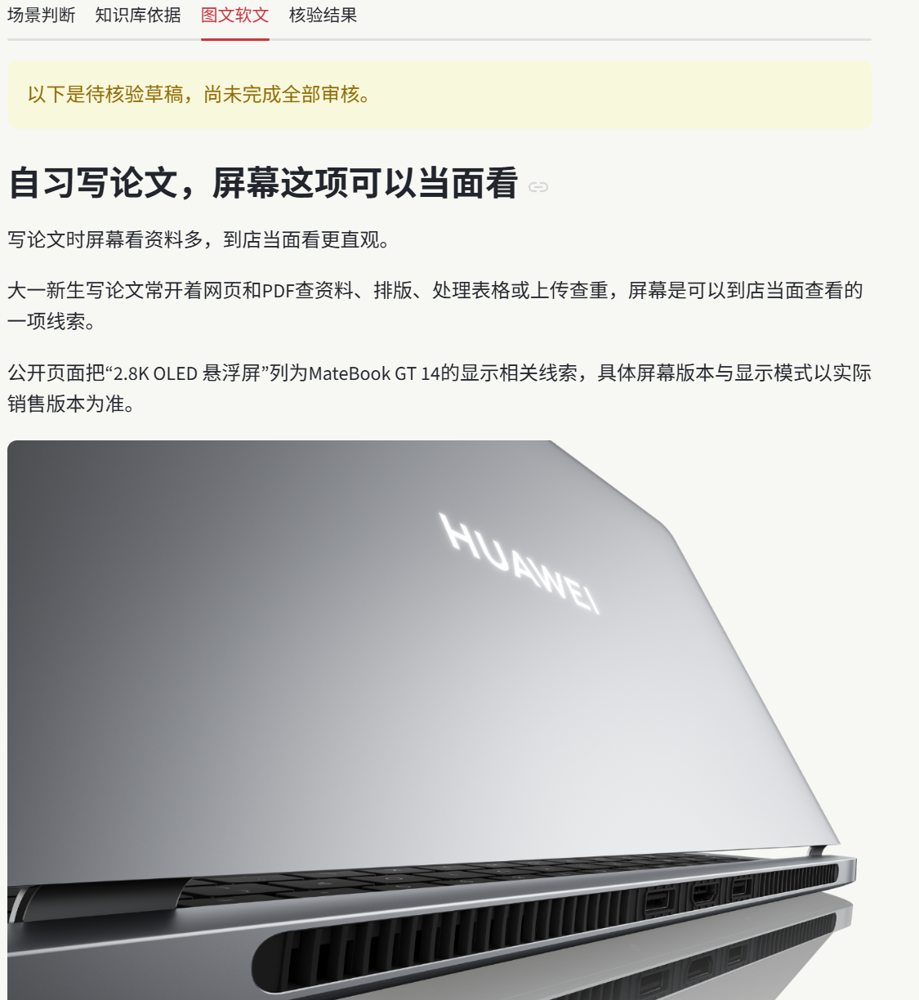
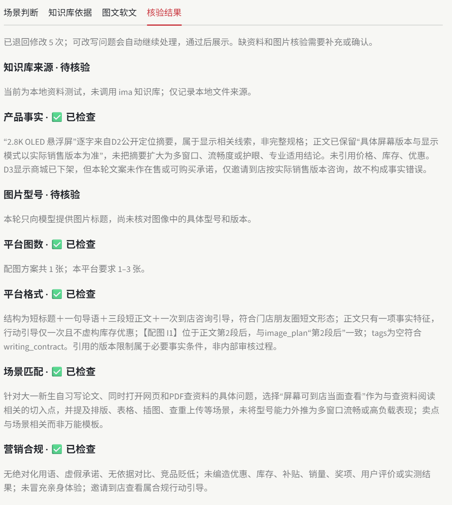

# 作品说明书 · 华为 PC 营销创作台（浙客松 · 华为产业进阶赛道）

> 赛题：AI+华为PC营销软文智能体。本作品为自研 Agent：ima 仅作为华为产品事实与图片素材来源；需求理解、场景与平台策略、系统提示词、图文组织、事实核验与合规检查均由自研流程完成。

## 一、功能讲解

面向华为门店导购与内容运营。用户在对话框中**用自然语言自由描述任务**（产品、人群、场景、平台均不设固定选项），系统按以下主线完成"理解需求 → 查找资料 → 选择图片 → 生成内容 → 核验结果"闭环：

1. **需求理解（角色 A1a）**：模型从对话中提取产品、受众、场景、平台四个必需项及选填的内容目标、补充要求。有缺失或模糊时**一次性列齐全部待补项**，追问轮数不限，不用假设或默认值补齐。**场景必须具体到实际任务**——只填"学习""办公""设计"这类笼统标签时，系统会继续追问实际做什么、用什么软件、怎样操作或负载情况（例如"用 WPS 写课程论文，浏览器查文献，同时开十几个 PDF，常带去图书馆"），因为场景细节决定内容切入点与卖点组织；但用户的需求不等于产品已具备相关性能，性能结论仍只能引用知识库资料。四要素齐全后生成需求摘要，**经用户确认后才读取资料**；型号疑似有误先澄清（例如不会擅自把"GT 4"改为"GT 14"）。
2. **资料与图片检索（角色 A1b）**：通过 ima OpenAPI 在指定共享知识库"任德耀新建华为PC知识库"中按型号检索文档与图片；搜索为空时回退浏览目录；相近型号做隔离，不混用参数与图片；保留每份资料的标题与来源，图片可追溯。
3. **图文写作（角色 A2）**：依据资料原文与平台规则生成标题、正文、行动引导与配图方案（每张图含名称、来源、说明、建议插入位置）。场景决定内容切入点，平台决定结构、语气、图数与行动引导；正文中每个产品事实都对应知识库原文摘录。首次写作前即向模型提供本平台具体的结构、语气、卖点数、图数与插图位置规则。
4. **独立审核（角色 A3）**：六项检查——产品事实、图片型号、平台图数、平台格式、场景匹配、营销合规。审核是与写作分离的独立模型调用；可改写问题连同具体意见与资料原文退回 A2 重写并复核，页面逐轮接续、可暂停；资料冲突直接阻断，不展示文案。无依据的价格、补贴、库存、绝对化宣传、无依据对比、竞品贬低、伪造个人体验一律拦截或标注待确认。
5. **展示与导出**：按赛题手册统一输出格式交付四部分——场景判断 / 知识库依据 / 图文软文 / 核验结果。**正文按配图方案的位置展示选中的实际图片**（PNG/JPEG，带来源、说明与型号待核验标记），不只是文字配图说明。提供**"图文与原图 ZIP 下载"**：包内为四部分 Markdown 记录与 `images/` 原图文件夹，使用可随文件夹移动的相对路径引用，解压即可按正文查看配图；缺图时明确提示，不生成占位图或缺图包。也可单独复制文字或导出 Markdown；导出不包含内部媒体 ID 与临时访问地址。

## 二、真实运行结果

**已验证的完整真实案例**（详见 `验证记录.md`）：

- 任务：MateBook GT 14 / 大学生社团视频剪辑同学 / 宿舍剪辑活动视频、整理素材交给队友 / 门店朋友圈 / 邀请到店咨询、不写价格。
- 检索：通过官方 `ima-skill/ima_api.cjs` 从指定共享库实际读取 3 份原文与 1 张候选图，返回 `status=ok`：
  - `54-MateBook GT 14 长页.md`
  - `09-HUAWEI MateBook GT 14.md`
  - `HUAWEI MateBook GT 14-价格卡.md`
  - 图片 `hwpc_matebook-gt-14_超能性能释放_04.png`
- 生成与审核：初稿经 **2 次针对性退回修改、3 轮独立审核**后，产品事实、平台图数、平台格式、场景匹配、营销合规五项通过；图片画面型号保持"待核验"，未标注为全部通过。前两轮被退回的实际问题包括"朋友圈并列多项卖点""场景与事实联系不足"，修改后仅保留可追溯的事实与适用限制。
- 过程中模型曾正确执行资料边界：价格卡显示原商城商品页已下架，成稿未虚构当前价格与促销。

**页面运行截图**（`说明书配图/` 目录）：

> 说明：截图拍摄时 ima 接口额度处于官方限制期（接口返回"资料获取次数已达上限"），故画面为**本地资料测试模式**，页面中"未调用 ima"的标注即此含义；需求理解、写作、审核均为真实 DeepSeek 调用。真实 ima 完整运行记录见上文"已验证的完整真实案例"及 `验证记录.md`。

截图对应的实际任务：MateBook GT 14 / 大一新生 / 自习写论文（常开网页和 PDF 查资料，需排版、表格处理、查重上传，常带去自习地点）/ 门店朋友圈。

**图 1 · 需求理解**：用户只说"写论文，朋友圈"，系统连续两轮追问场景细节——先问常用软件、是否同时打开大量网页或 PDF、是否常带去自习地点；用户答"软件不知道，会，会"后继续追问排版、表格、图片插入、查重上传等具体操作，**不用假设补齐**。

**图 2 · 场景与依据**：知识库依据板块——实际读取的 3 份资料（`54-MateBook GT 14 长页.md`、`09-HUAWEI MateBook GT 14.md`、`HUAWEI MateBook GT 14-价格卡.md`）与候选原图，来源逐条可查。

**图 3 · 图文软文**：朋友圈短文（短标题＋一句导语＋三段短正文＋到店咨询引导），正文指定位置展示实际图片；全文仅引用一项有据特征"2.8K OLED 悬浮屏"，并保留"具体屏幕版本与显示模式以实际销售版本为准"的限制条件。

**图 4 · 核验结果**：经 5 次退回修改后，产品事实、平台图数、平台格式、场景匹配、营销合规五项通过；"知识库来源（本地模式）"与"图片型号（仅按标题筛选）"两项如实标注待核验。产品事实项注明成稿表述与 D2 原文逐字对应、未把摘要扩大为流畅度或护眼结论；价格卡显示商品已下架，成稿未作在售或可购买承诺，仅邀请到店按实际销售版本咨询。

## 三、自研 Agent 与提示词设计

- 三个轻量角色（需求理解+查资料 / 写作 / 审核）共用一个 DeepSeek 适配器（`llm.py`），按角色使用不同系统提示词；**不是对 ima 的转发**——ima 仅返回资料原文与图片，所有策略、组织与判断由自研流程完成。
- 本地程序另做**可量化校验**（不依赖模型自觉）：需求清单完整性、平台图数、正文插图标记与配图方案一一对应、**引用原句是否真实存在于资料原文**。审核意见逐条反馈给写作角色，每轮继续携带资料原文。
- 系统提示词按赛题手册要求的模块编写，位于 `prompts/` 目录：角色与任务、场景理解、平台规则、知识库约束（事实只能来自指定共享库）、图片规则、生成要求、核验规则（无依据不生成、资料冲突停止输出并提示人工确认）、合规规则。八类常见场景的内容重点存于 `prompts/scenario_reference.md`，仅作写作参考，不限制用户自由描述场景。

## 四、ima 调用方式

官方 ima Skill 完整保留于 `ima-skill/`，统一入口 `ima-skill/ima_api.cjs`：按名称查找知识库取得 kb_id → 搜索为空回退 `get_knowledge_list` 浏览目录 → `search_knowledge` 按型号与任务检索 → `get_media_info` 读取原文与图片。调用设有次数与总时长预算，超时终止；读取失败不自动改用本地文件或模拟结果；不声称已查遍全库。

## 五、测试与质量记录（两种资料来源 + 自动化测试体系的说明）

页面提供**两种资料来源**，用途明确、严格隔离：

| 模式 | 资料来源 | 模型 | 用途 | 是否作为赛事结果 |
| --- | --- | --- | --- | --- |
| **真实资料** | 实时调用 ima 指定共享知识库 | DeepSeek | 正式使用与演示，全部赛事结果均产自该模式 | ✅ 是 |
| **本地资料测试**（页面默认） | 项目内保存的产品资料实际文件，页面、复制与导出均明确标注"本地资料测试，未调用 ima" | DeepSeek | 日常开发与联调：不消耗 ima 接口额度即可完整走通需求理解→写作→审核流程 | ❌ 否 |

**为什么需要本地资料测试**：ima OpenAPI 对资料读取设有官方额度上限（实际使用中曾遇到"资料获取次数已达上限"的返回）。而开发调试阶段需要反复运行完整流程——每次改代码都要验证需求理解、写作、审核、导出是否仍然正确——若每次都走真实接口，有限的额度会被调试消耗殆尽，影响正式使用。因此设置本地资料测试作为**额度不足时的代用调试模式**：使用项目内保存的资料实际文件替代接口返回，需求理解、写作、审核仍调用真实 DeepSeek 模型，仅"资料获取"这一步不消耗 ima 额度。该模式的所有页面、结果、复制与导出均强制标注"未调用 ima"，与正式结果严格区分。

设计隔离纪律：真实模式检索失败时**不会**自动回退本地文件或模拟素材；切换模式会清空旧结果，避免两种来源的记录混淆。

此外还有一套**不接入页面的自动化离线测试**：使用虚构资料与替身响应，在每次代码改动后快速验证追问、拦截、审核、导出等逻辑是否仍然正确，不联网、不调用任何真实服务。页面中不存在"模拟生成"入口，离线测试数据不可能被误当作运行结果。

质量记录：

- **130 项本地离线检查全部通过**（最近记录耗时 9.810 秒），覆盖：追问与列齐缺项、笼统场景强制澄清、自由具体场景、需求确认、型号澄清、真实/本地来源隔离、四平台结构检查、A3 六项审核完整性、退回重写与暂停续写、资料冲突阻断、正文实际图片排版与 ZIP 原图一致性、导出脱敏、搜索回退目录、相近型号隔离、凭证脱敏等，清单见 `测试清单.md`。
- 图片交付专项验证：使用项目内 MateBook GT 14 实际资料，分别检查公众号 2 图、小红书 3 图、朋友圈 1 图、海报 1 图的完整解码、正文插图对应及 ZIP 原图字节一致性。缺失、损坏、明确错型号和完全相同的重复素材不能用于交付；写作前、审核后、展示和导出时均检查。这是素材文件交付测试，不是四平台营销成稿或画面型号核验，记录见 `验证记录.md`。
- 页面交互经 Streamlit AppTest 验证；服务健康检查返回正常。
- 真实连接单独验证：DeepSeek JSON 接口返回有效结果；ima 正式读取流程实际获取原文与图片成功。

## 六、部署与运行

环境：Python 3.15.0、Streamlit 1.66.0、Pillow 12.3.0、Node.js ≥18（执行官方 ima 脚本）。Pillow 用于验证图片文件完整可读；模型与 ima 调用使用标准库。安装 `requirements.txt` 后在项目 `.env` 填写 `IMA_OPENAPI_CLIENTID`、`IMA_OPENAPI_APIKEY`、`DEEPSEEK_API_KEY`（模板见 `.env.example`），双击 `启动.cmd` 后访问 http://127.0.0.1:8501/ 。详见 `README.md`。魔搭页面用于项目介绍、运行截图和源码导航；实际交互程序按 README 在本地运行。

## 七、合规与安全

- 凭证仅存本地 `.env`，不进入代码、Git 历史、截图与演示画面；接口错误信息脱敏后展示，不输出请求头与原始错误响应。
- 知识库没有依据的信息（价格、补贴、库存、服务承诺）不生成；用户要求加入时改为"到店咨询"或提示补充正式资料。
- 交付内容明确定位为"待核验草稿"，核验记录逐项展示，未通过项不标为全部通过。

## 八、已知限制（如实说明）

- 图片目前按标题与来源筛选，画面内容尚未做图像识别核验，配图型号保留"待核验"标记。
- 本地校验能确认引用原句存在，语义充分性仍依赖审核模型，可能漏检；不能保证任意输入下必然生成成稿。
- 单次最多读取 3 份文字资料与平台最低数量的候选图片；文档支持 UTF-8 Markdown/txt，图片支持 JPEG/PNG。ima 接口存在官方资料读取额度上限，耗尽时页面明确显示官方提示并停止后续读取，不会谎称"库中不存在"。
- 自由场景的细节是否足够具体由模型参与判断，可能漏判；程序已拦截常见笼统标签，但不能保证所有自然语言表达都判断正确。
- 个别任务的自动退回重写轮数较多（实测中曾出现 12 轮才收敛），长任务等待时间偏长；审核尺度与写作提示词的配合仍在调优，目标收敛在 3 轮以内。
- 会话记录仅保存在当前浏览器会话，需要留存请导出。当前真实成稿案例覆盖门店朋友圈，其余平台的真实样例仍在补齐。

## 九、链接

- GitHub：https://github.com/cycling66666/cycling
- 魔搭：https://modelscope.cn/studios/cycling66666/Huawei_PC_Marketing_Studio
